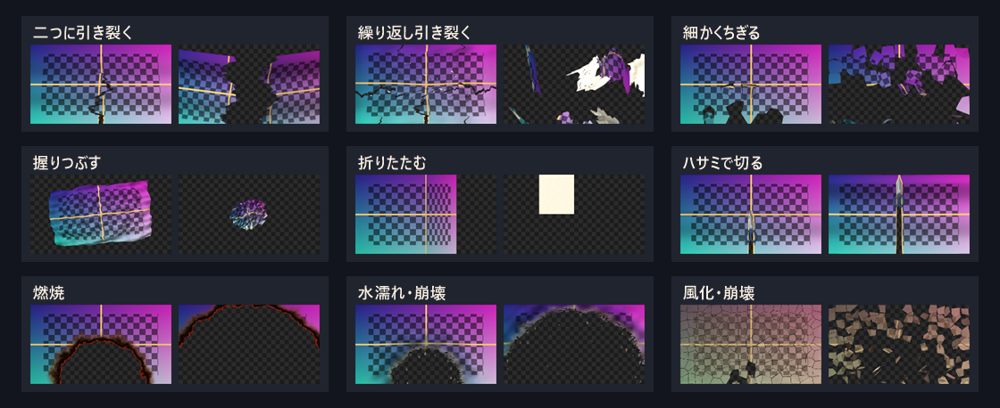

# 紙消失（SYNC_PaperBreak）

AviUtl2の画像オブジェクトに追加できる「SYNC」シリーズのフィルターです。元の画像を紙に見立て、引き裂く、折りたたむ、燃やすなど、9種類の演出で消失させます。

[SYNC_PaperBreak.zip をダウンロード](https://github.com/vramwiz/SYNC_PaperBreak/releases/latest/download/SYNC_PaperBreak.zip)

## インストール

1. `SYNC_PaperBreak.zip` を解凍します。
2. 中の `SYNC_PaperBreak` フォルダーを `C:\ProgramData\aviutl2\Plugin` に入れます。更新時は既存ファイルを上書きします。
3. AviUtl2を起動します。すでに開いている場合は再起動します。

## 使い方

1. 画像オブジェクトを選択し、フィルタ効果「紙消失」を追加します。
2. 「スタイル」と「消失時間」を設定します。消失時間はオブジェクトの先頭から完全に透明になるまでの秒数です。先頭フレームは元の画像がそのまま表示されます。
3. オブジェクトを消失時間より長く配置すると、完全に消えるところまで確認できます。消失後はオブジェクトの終端まで透明のままです。

## 演出

| スタイル | 動き |
| --- | --- |
| 二つに引き裂く | 指定位置から破断が進み、反動で反った2枚の紙片が離れて落下します。 |
| 繰り返し引き裂く | 破断後の紙片を時間差でさらに分割します。 |
| 細かくちぎる | 不規則な形の紙片が順次ちぎれ、個別に回転して落下します。 |
| 握りつぶす | 波打つ紙を中心に押し込み、しわと重なりがある紙の塊が落下します。 |
| 折りたたむ | 3本の折り軸で順に折り、重ねた紙が落下します。 |
| ハサミで切る | 刃が閉じる動きに合わせて切断点が進み、切れた紙が分離します。 |
| 燃焼 | 紙面はその場に留まり、焦げと赤熱を伴う焼失境界が広がります。 |
| 水濡れ・崩壊 | 印刷のにじみや膨張、波打ちが広がり、湿った繊維状の紙片が落下します。 |
| 風化・崩壊 | 変色とひびが進み、不規則な細片が離れます。 |

## パラメータ

| 項目 | 範囲 | 初期値 |
| --- | --- | --- |
| スタイル | 上の9種類 | 二つに引き裂く |
| 消失時間 | 0.01～100秒 | 3秒 |
| 開始角度 | 0～360° | 270° |
| 開始位置 | 0～100 | 100 |
| 紙の厚さ | 0～100 | 10 |
| 紙の硬さ | 0～100 | 50 |
| 変形強度 | 0～100 | 50 |
| 重力 | 0～100 | 50 |
| 飛散強度 | 0～100 | 30 |
| ランダムシード | 32ビット符号付き整数 | 0 |

開始角度は右が0°、上が90°、左が180°、下が270°です。開始位置は画像中心を0、その方向の長方形外周を100として指定します。ハサミは指定角度の外周から入ります。

## ライセンス

本体はGPL-3.0-onlyです。 [ライセンス全文](LICENSE) · [第三者ライセンス](THIRD_PARTY_NOTICES.md)
